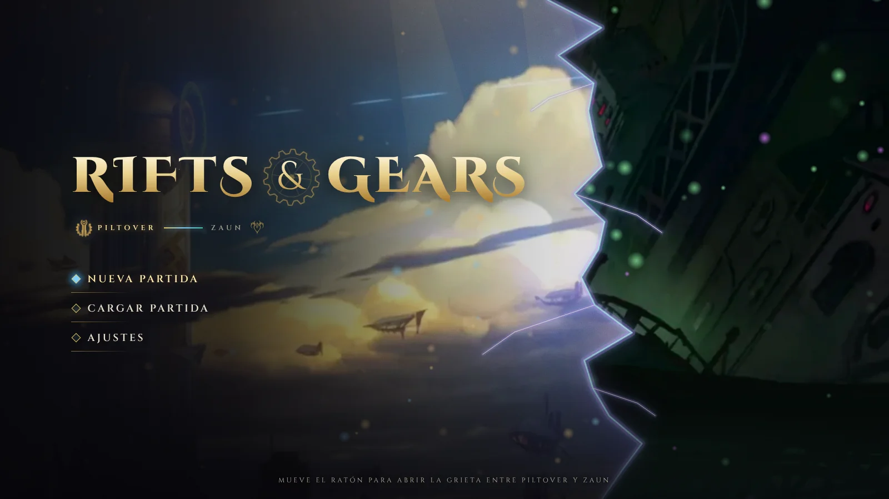
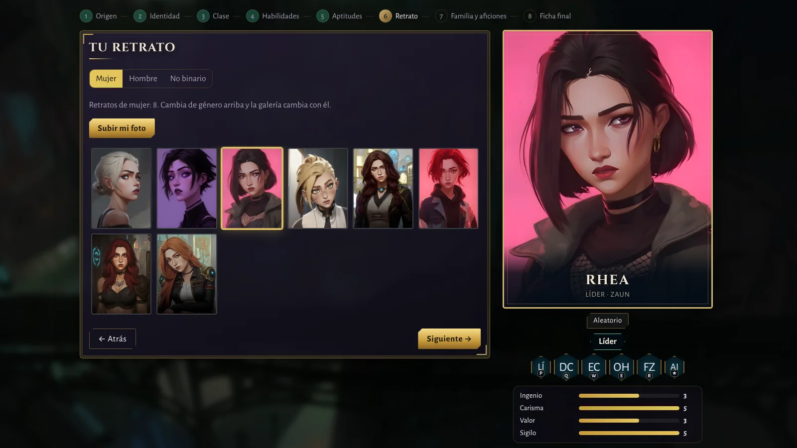
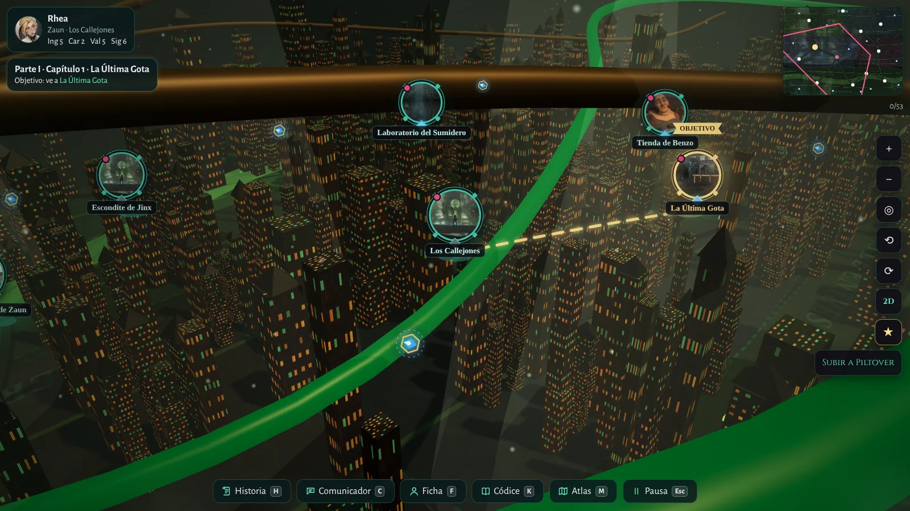

# GUIA.md · Funcionamiento completo de Rifts & Gears
**Manual técnico y de uso: jugar sin código, desarrollar con código, arquitectura, compilación y exportación**

> **Cómo leer este manual:** empieza por la sección 2 si solo quieres jugar. Si vas a editar el proyecto, continúa por las secciones técnicas. Los comandos y rutas se basan en la configuración del repositorio. Un archivo documentado no equivale a una función probada en todas las plataformas.

## Índice

1. Qué es el proyecto y qué está implementado
2. Usar el juego sin instalar herramientas de programación
3. Preparar el entorno de desarrollo
4. Arquitectura y recorrido de una partida
5. Qué archivo editar para cada tipo de cambio
6. Historia y estado de partida
7. IA: funcionamiento, configuración y límites
8. Mundo 3D, modelos y rendimiento
9. Audio y música
10. Guardados y datos del usuario
11. Web estática y publicación en Render
12. Compilar para escritorio y Android
13. Exportar una copia del repositorio
14. Flujo de trabajo con Git
15. Pruebas antes de publicar
16. Solución de problemas
17. Guías relacionadas y propiedad intelectual

---

## 1. Qué es Rifts & Gears

Rifts & Gears es un juego narrativo de fans inspirado en la estética y el universo de *Arcane*. El jugador crea un protagonista, escoge un origen, toma decisiones en la historia, desarrolla relaciones con personajes, explora localizaciones y accede a actividades y minijuegos.

El repositorio contiene la fuente del juego, datos narrativos, arte y recursos del proyecto, herramientas de compilación, una web promocional y guías de desarrollo. No es necesario conocer JavaScript para jugar una versión compilada.

### Estado conocido de los sistemas

| Sistema | Qué hay en el repositorio | Qué no debes dar por garantizado |
|---|---|---|
| Historia | Archivos de escenas, decisiones, rutas y finales. | Que cada ruta esté probada de principio a fin en cada versión. |
| Creación | Creador por pasos para origen, identidad, clase, habilidades, aptitudes, retrato, familia/aficiones y ficha final. | Que todas las combinaciones posibles estén equilibradas narrativamente. |
| Mapa | Mapas de Piltover y Zaun; existe un renderizado 3D y una alternativa visual 2D. | Que todos los lugares tengan un modelo 3D detallado e independiente. |
| Personajes 3D | Soporte para escena Three.js y modelos locales en formatos compatibles. | Que cada personaje tenga modelo original terminado y animaciones completas. |
| Conversaciones | Diálogos escritos y chat libre con IA opcional. | Que un proveedor de IA funcione sin configuración o internet/red cuando no es local. |
| Audio | Música procedural y efectos generados mediante Web Audio. | Que existan tres archivos musicales finales MP3/OGG ya exportados e integrados. |
| Escritorio | Configuración de Electron y empaquetado para Windows/macOS. | Que cualquier build haya sido instalada y probada en un equipo real. |
| Android | Proyecto y sincronización mediante Capacitor. | Que cada APK o AAB esté firmado, publicado o probado en todos los dispositivos. |
| Web | Generador de sitio estático que produce <code>web-dist/</code>. | Que la web sea el instalador del juego de escritorio. |

**Música, para evitar confusiones:** el código actual de <code>src/js/audio.js</code> genera sonido en tiempo real. Los identificadores de música son <code>wiki</code> (menú), <code>piltover</code> y <code>zaun</code>. Las tres pistas independientes renderizadas siguen pendientes hasta contar con archivos finales con licencia comprobada e integración probada.

**IA, para evitar confusiones:** el juego puede usar diálogo escrito sin servidor de lenguaje. Para el chat con IA se debe elegir y configurar un proveedor y un modelo; la velocidad y la calidad dependen del equipo, del servidor y del modelo.

## 2. Usar el juego sin instalar herramientas de programación

Esta es la ruta adecuada si quieres jugar, probar una descarga o ayudar a encontrar errores, pero no quieres editar código.

1. Abre [Releases](https://github.com/MarinaDP2006/RIFTS-GEARS/releases) y busca una versión publicada para tu dispositivo.
2. Si no hay un lanzamiento disponible, consulta [GitHub Actions](https://github.com/MarinaDP2006/RIFTS-GEARS/actions). Un artefacto solo se considera listo si su ejecución terminó correctamente.
3. Descarga el archivo de este repositorio y sigue las instrucciones incluidas con esa versión.
4. Inicia una partida nueva para aprender el juego. Conserva tu partida personal aparte.
5. Si algo falla, anota versión, dispositivo, pasos para reproducirlo y resultado esperado/real. Usa la plantilla de [GUIAJUEGO.md](GUIAJUEGO.md).

No necesitas VS Code, Git ni Node.js para ejecutar una descarga ya compilada.

### Capturas de referencia

Estas imágenes son capturas reales almacenadas en el repositorio. Algunas pueden proceder de una versión anterior y la interfaz puede cambiar entre versiones.

## 3. Preparar el entorno de desarrollo

### Requisitos

- Git.
- Node.js compatible con las dependencias fijadas por el proyecto.
- Un editor como Visual Studio Code (opcional, pero útil).
- Para compilar Android: Android Studio y las herramientas del SDK correspondientes.
- Para probar el chat local: Ollama o LM Studio y un modelo compatible, si vas a utilizar un proveedor local.

### Clonar, instalar, comprobar y arrancar

Abre la terminal y ejecuta:

~~~bash
git clone https://github.com/MarinaDP2006/RIFTS-GEARS.git
cd RIFTS-GEARS
npm ci
npm run check
npm start
~~~

Qué significa cada comando:

- <code>git clone</code>: descarga una copia del repositorio.
- <code>npm ci</code>: instala las dependencias que corresponden al lockfile.
- <code>npm run check</code>: ejecuta las comprobaciones automatizadas definidas por el proyecto. No sustituye una prueba manual.
- <code>npm start</code>: inicia el juego con Electron en el escritorio.

Para generar la web estática: <code>npm run web</code>. Para intentar generar el instalador/portable de Windows: <code>npm run dist:win</code>. Revisa la sección 12 antes de compilar para otra plataforma.

Si un comando falla, conserva el mensaje completo, la versión de Node.js y el sistema operativo. Evita borrar carpetas de datos o archivos de bloqueo como primer intento de reparación.

## 4. Arquitectura y recorrido de una partida

### Diagrama simplificado

~~~mermaid
flowchart TD
    A[Arranque: src/index.html] --> B[Datos: src/data]
    A --> C[Módulos: src/js]
    B --> D[Historia, personajes, mapa, relaciones y diálogos]
    C --> E[Interfaz y creador]
    C --> F[Motor de partida: game.js]
    C --> G[Mundo / Three.js]
    C --> H[Audio Web Audio]
    C --> I[Chat IA opcional]
    E --> F
    D --> F
    F --> J[Guardado de partida]
    I --> F
    K[Electron / Capacitor / web estática] --> A
~~~

### Archivos y carpetas principales

| Ruta | Para qué sirve |
|---|---|
| <code>src/index.html</code> | Entrada de la aplicación y orden de carga de los datos y módulos. |
| <code>src/css/</code> | Estilos de las pantallas, botones y componentes. |
| <code>src/js/app.js</code> | Navegación general de la interfaz: menú, juego y ajustes. |
| <code>src/js/creator.js</code> | Pasos de creación del protagonista y validación de la ficha. |
| <code>src/js/game.js</code> | Estado de la partida, progresión, conversaciones y guardado. |
| <code>src/js/world.js</code> | Mapa, lugares, gestos e interacción con la vista del mundo. |
| <code>src/js/world3d.js</code> | Escena tridimensional generada con Three.js. |
| <code>src/js/ai.js</code> | Proveedores, peticiones y respuesta del chat de IA. |
| <code>src/js/audio.js</code> | Música procedural, ambientes y efectos de audio. |
| <code>src/data/story.js</code> | Datos de la historia base. |
| <code>src/data/story-expansion.js</code> | Extensiones de historia. |
| <code>src/data/alternate-fates.js</code> | Contenido y condiciones de destinos alternativos. |
| <code>src/data/chat.js</code>, <code>chat-expansion.js</code>, <code>chat-deep.js</code> | Conversaciones preparadas y sus expansiones. |
| <code>src/data/guia.js</code> | Introducción al mundo y fichas de personajes sin spoilers importantes. |
| <code>src/data/ai-voices.js</code>, <code>arcane-lore.js</code> | Rasgos de voz, biografía y contexto que se suministran al chat de IA. |
| <code>src/data/relations.js</code> | Relaciones y vínculos entre personajes. |
| <code>main.js</code>, <code>preload.js</code>, <code>modelos.js</code> | Integración de escritorio y acceso a capacidades de Electron. |
| <code>scripts/</code> | Scripts de comprobación, generación de la web y preparación de la versión móvil. |
| <code>web/</code> | Fuente de la web promocional. |
| <code>web-dist/</code> | Resultado generado para publicación estática; no edites su contenido generado a mano. |
| <code>android/</code> | Proyecto de Android sincronizado con Capacitor. |
| <code>.github/workflows/</code> | Automatizaciones de validación y compilación. |

### Qué ocurre cuando juegas

1. <code>src/index.html</code> carga los módulos y datos en el orden declarado.
2. El menú permite comenzar una partida o acceder a una existente y a los ajustes.
3. El creador solicita los datos del protagonista y construye la ficha de juego.
4. El motor de partida mantiene el progreso, la ruta, el capítulo, las relaciones, las personas conocidas y los eventos.
5. Los archivos de datos definen escenas y opciones. El motor aplica el resultado de la elección.
6. El mundo dibuja el mapa disponible y permite inspeccionar lugares y abrir sus acciones.
7. El sistema de guardado conserva los datos para continuar más tarde.
8. Si se habilita IA, se envía al proveedor la petición configurada. La respuesta se usa como texto de conversación; no debe tener autoridad para ejecutar código ni para modificar arbitrariamente las reglas del juego.

## 5. Qué archivo modificar para cada cambio

| Objetivo | Punto de partida |
|---|---|
| Corregir la pantalla de inicio o los ajustes | <code>src/js/app.js</code> y <code>src/css/</code>. |
| Cambiar la creación del personaje | <code>src/js/creator.js</code> y los datos de <code>src/data/creation.js</code>. |
| Añadir escenas y elecciones | <code>src/data/story.js</code> o <code>src/data/story-expansion.js</code>. |
| Añadir una condición de destino alternativo | <code>src/data/alternate-fates.js</code> y la lógica del motor que actualiza los personajes/flags. |
| Editar diálogos escritos | <code>src/data/chat.js</code>, <code>src/data/chat-expansion.js</code> o los módulos de conversación profunda. |
| Afinar el tono de los personajes de IA | <code>src/data/arcane-lore.js</code>, <code>src/data/ai-voices.js</code> y <code>src/js/ai.js</code>. |
| Cambiar audio | <code>src/js/audio.js</code>. |
| Cambiar una ciudad o el mapa | Datos de <code>src/data/world.js</code> y módulos del mapa y del mundo 3D. |
| Cambiar instrucciones sin spoilers | <code>src/data/guia.js</code>. |
| Cambiar la web de presentación | Archivos de <code>web/</code> y luego ejecutar <code>npm run web</code>. |

### Ejemplo: corregir un diálogo escrito

1. Abre el archivo de datos de la conversación correspondiente.
2. Busca el identificador de la escena o nodo.
3. Cambia el texto y revisa todas las opciones que apuntan a otros nodos.
4. Ejecuta <code>npm run check</code>.
5. Inicia el juego y llega a ese diálogo desde una partida de prueba.

No cambies identificadores de escenas, rutas, capítulos o finales sin revisar las referencias. Una etiqueta visible puede traducirse, pero un ID usado por el guardado debe conservar compatibilidad o requerir una migración explícita.

## 6. Historia y estado de partida

La narrativa combina archivos de escenas con el estado mantenido por el motor. Entre los datos que pueden formar parte de ese estado están el protagonista, la ruta, el capítulo y nodo actuales, las afinidades, los eventos/flags, los personajes conocidos, las conversaciones, los lugares visitados y los finales alcanzados.

**Para añadir una elección narrativa:**

1. Define el texto y las opciones en el archivo de historia.
2. Asigna a cada opción una transición válida.
3. Si una opción cambia una condición, usa el mecanismo de estado que ya utilice el proyecto, en lugar de guardar el cambio solo en la interfaz.
4. Asegúrate de que las consecuencias posteriores consulten la condición.
5. Revisa las rutas de éxito, rechazo, volver atrás y cargar una partida antigua.
6. Comprueba que las traducciones y el códice no queden incoherentes.

Prueba los cambios usando una partida aparte. No sobrescribas tu único guardado personal para probar un final alternativo.

## 7. IA: funcionamiento, configuración y límites

### Sin IA

Los diálogos escritos en los archivos de datos no necesitan instalar un modelo lingüístico. Mantén esta opción funcional para que el jugador pueda seguir la historia sin configurar nada externo.

### Con IA local

El módulo <code>src/js/ai.js</code> declara opciones para Ollama y LM Studio, además de un proveedor personalizado compatible. El modelo se ejecuta por separado y no viene incluido en el repositorio.

- Para LM Studio, sigue [GUIA-LM-STUDIO.md](GUIA-LM-STUDIO.md).
- Para el prompt, voces y campaña, sigue [GUIA-IA-Y-CAMPANA.md](GUIA-IA-Y-CAMPANA.md).
- La configuración exacta que aparece en pantalla depende de la versión del juego.

### Ejemplo conceptual de petición compatible con Chat Completions

Este ejemplo sirve para entender el formato; no sustituye a la configuración interna ni contiene una clave real:

~~~javascript
const response = await fetch("http://localhost:1234/v1/chat/completions", {
  method: "POST",
  headers: { "Content-Type": "application/json" },
  body: JSON.stringify({
    model: "nombre-del-modelo-cargado",
    messages: [
      { role: "system", content: "Interpreta al personaje sin controlar las reglas del juego." },
      { role: "user", content: "¿Qué opinas de lo que acaba de ocurrir?" }
    ],
    temperature: 0.7,
    max_tokens: 350
  })
});
if (!response.ok) throw new Error("El servidor de IA devolvió un error");
const data = await response.json();
console.log(data.choices?.[0]?.message?.content ?? "Respuesta vacía");
~~~

En el proyecto real, el módulo de IA también decide proveedor y URL, aplica la ruta de petición adecuada a escritorio/Android/navegador y utiliza contexto del juego. Al modificar esa lógica, conserva controles de timeout, manejo de errores y la posibilidad de continuar sin IA.

### Seguridad y privacidad

- No subas tokens, contraseñas, claves API ni credenciales.
- Nunca expongas un servidor de modelo local a Internet sin una arquitectura segura.
- En móvil, <code>localhost</code> es el propio teléfono/tableta, no el ordenador.
- Trata la respuesta como texto no confiable; no ejecutes HTML, JavaScript ni comandos recibidos del modelo.
- El modelo puede inventar datos o saltarse instrucciones. El motor debe controlar misiones, inventario, afinidades y finales.
- Prueba la experiencia con el servidor apagado, sin conexión, lento y devolviendo un error.
- Comprueba los ajustes locales antes de prestar el dispositivo o compartir registros.

## 8. Mundo 3D, modelos y rendimiento

El mapa utiliza datos de localizaciones, una vista que admite interacción táctil/ratón y código de renderizado 3D. Existe una alternativa gráfica 2D para las situaciones en que se use o necesite ese modo. La calidad y el rendimiento dependen del equipo y de los recursos que se carguen.

### Modelos personales

El proyecto tiene un sistema para cargar modelos personales compatible con varios formatos según el tipo de recurso. Consulta [GUIA-MODELOS-3D-Y-PRUEBAS.md](GUIA-MODELOS-3D-Y-PRUEBAS.md) para la ruta exacta, formatos, texturas y procedimiento de diagnóstico.

Antes de incluir un modelo:
1. Verifica permiso y licencia para usarlo y redistribuirlo.
2. Comprueba que escala, orientación, materiales, texturas y pose son correctos.
3. Reduce polígonos y textura si el dispositivo va lento.
4. Conserva los archivos privados fuera del repositorio.
5. Comprueba que la escena puede seguir cargando cuando ese modelo no está.

Para modelos creados en Blender, una exportación a GLB suele simplificar la distribución de mallas y texturas, pero aun así hay que revisar el resultado.

## 9. Audio y música

El código de <code>src/js/audio.js</code> sintetiza audio mediante Web Audio. Los temas existentes utilizan los identificadores <code>wiki</code> (menú), <code>piltover</code> y <code>zaun</code>, y hay también sonidos ambientales y efectos.

**No están confirmadas tres pistas de audio independientes generadas, subidas e integradas.** Para considerar terminado ese trabajo debe existir cada archivo final en el repositorio, haber comprobado su licencia y tamaño, y haberlo conectado al reproductor. Después se debe probar el cambio de ubicación, volumen, silencio, loop, empaquetado web/escritorio/móvil y la reproducción real. La generación de música externa no se considera realizada hasta que los archivos se hayan recibido y probado.

La carpeta de referencia es [assets/music/README.md](assets/music/README.md). No utilices melodías, stems ni grabaciones de la banda sonora oficial de *Arcane*.

## 10. Guardados y datos personales

En Windows, la guía del proyecto indica esta carpeta habitual:

~~~text
%APPDATA%\Arcane Piltover y Zaun\partidas
~~~

Las ranuras pueden tener una copia anterior con extensión <code>.bak</code>. En Android, la partida vive dentro de la app salvo que se exporte; las carpetas internas no deben suponerse accesibles desde el explorador de archivos.

- Exporta una ranura desde el menú de partidas.
- Guarda una copia fuera de la carpeta que utiliza el juego antes de actualizar o probar migraciones.
- Prueba importar una copia y no el único archivo original.
- No subas partidas ni datos privados al repositorio.

Consulta [partidas-guardadas-guia.md](partidas-guardadas-guia.md) para instrucciones detalladas, incluida la transferencia entre dispositivos.

## 11. Web estática y publicación en Render

La web pública no es el instalador de escritorio. Se genera desde <code>web/</code> y datos del juego.

~~~bash
npm run web
~~~

El resultado se escribe en <code>web-dist/</code>. La configuración de Render está en <code>render.yaml</code>, con el comando de compilación <code>node scripts/build-web.js</code> y la carpeta publicada <code>web-dist</code>.

Antes de publicar:
- Asegúrate de que el generador termina correctamente.
- Comprueba que las imágenes y rutas existen y que no dependen de una carpeta privada de tu ordenador.
- Usa capturas reales y con permiso de publicación.
- No muestres nombres, claves, conversaciones privadas ni spoilers en capturas.
- Comprueba los enlaces de descarga y la página después del despliegue.

Guía extra: [GUIA-WEB-RENDER.md](GUIA-WEB-RENDER.md).

## 12. Compilar las aplicaciones

### Windows

En Windows, desde la raíz del proyecto:

~~~powershell
npm ci
npm run check
npm run dist:win
~~~

Los archivos resultantes deberían aparecer en <code>dist/</code> según los objetivos de <code>package.json</code>. Instala y ejecuta el instalador y el portable en un entorno de prueba; no asumas que una compilación sin errores garantiza un juego completamente funcional.

### macOS

El proyecto declara objetivos DMG y ZIP para arquitecturas Apple Silicon (arm64) e Intel (x64).

~~~bash
npm ci
npm run check
npm run dist:mac
~~~

La configuración del repositorio no equivale a firmar o notarizar la app. Para una distribución pública, revisa los requisitos actuales de macOS.

### Android

El proyecto utiliza Capacitor. Para preparar y sincronizar los recursos:

~~~bash
npm ci
npm run check
npm run android:sync
~~~

Después, compila con el workflow móvil o desde Android Studio, según el entorno disponible. Prueba el APK en un dispositivo físico y comprueba pantalla táctil, audio, permisos, red local, importación/exportación de partidas y reanudación tras cerrar la app. No presupongas que hay una APK firmada de tienda sin verificarlo en la compilación concreta.

## 13. Exportar y archivar el repositorio

### Archivo con historial Git

~~~bash
git clone https://github.com/MarinaDP2006/RIFTS-GEARS.git
cd RIFTS-GEARS
git fetch --all --prune
git bundle create ../rifts-gears.bundle --all
git bundle verify ../rifts-gears.bundle
~~~

El bundle preserva el historial y las referencias Git disponibles en el clon.

### ZIP de los archivos de una rama

~~~bash
git checkout main
git pull --ff-only
git archive --format=zip --output=../rifts-gears-source.zip main
~~~

Un ZIP de archivos no incluye el historial, los ficheros locales ignorados ni los recursos que no estén rastreados por Git. Comprueba el contenido antes de compartirlo. No incluyas modelos privados, guardados, tokens, claves ni assets sin permiso.

## 14. Flujo de trabajo recomendado con Git

1. Actualiza <code>main</code> y revisa el estado actual.
2. Crea una rama por tarea.
3. Cambia solo los archivos necesarios y revisa el diff completo.
4. Ejecuta las comprobaciones y pruebas relacionadas.
5. Comprueba licencias, rutas y que no se han añadido datos personales.
6. Abre un pull request que resuma cambios, pruebas realizadas y limitaciones.
7. Después de fusionar, revisa el estado de la rama de destino y la compilación correspondiente.

Comandos útiles:

~~~bash
git status
git switch -c docs/guia-funcionamiento
git diff --check
git diff
~~~

No uses un nombre de rama de ejemplo si ya existe; comprueba el listado local antes de crearla. No hagas push de claves o guardados personales.

## 15. Pruebas antes de publicar

- [ ] <code>npm ci</code> y <code>npm run check</code> terminan correctamente.
- [ ] Se puede arrancar, cerrar y volver a abrir.
- [ ] Se puede crear un personaje y recorrer las rutas disponibles.
- [ ] Los diálogos tienen transiciones válidas y no dejan la historia bloqueada.
- [ ] El mapa responde al ratón y al tacto donde corresponda.
- [ ] Los lugares abren el menú de acciones esperado.
- [ ] Guardar, cargar, exportar e importar funcionan con copias de prueba.
- [ ] Música, ambiente, efectos, volumen y silencio funcionan.
- [ ] El juego puede continuar con IA desactivada.
- [ ] La IA conecta, maneja timeout y muestra errores comprensibles.
- [ ] El layout funciona en los tamaños de pantalla objetivo.
- [ ] La web se genera y las imágenes de las guías se ven.
- [ ] Se prueba el instalador o APK real en el dispositivo de destino.
- [ ] Todos los recursos distribuidos tienen procedencia y permisos claros.

## 16. Problemas frecuentes

| Síntoma | Qué revisar |
|---|---|
| Falla <code>npm ci</code> | Versión de Node.js, conexión, espacio y error completo. |
| Electron no arranca | Ejecutar <code>npm run check</code> y volver a lanzar desde una terminal. |
| Una pantalla sale vacía | Orden de carga de scripts en <code>src/index.html</code> y errores de consola. |
| La web no se actualiza | Ejecutar <code>npm run web</code> y confirmar la publicación de <code>web-dist/</code>. |
| No hay sonido | Ajustes y volumen; interactuar con la pantalla para permitir iniciar el audio. |
| No conecta la IA | Proveedor, modelo cargado, URL, puerto, firewall, Wi-Fi y CORS. |
| El modelo 3D no aparece | Nombre, formato, textura, licencia, escala y guía de importación. |
| La partida no carga | No sobrescribirla: hacer una copia y probar con una ranura o copia anterior. |

## 17. Documentación adicional

- [GUIAJUEGO.md · Guía de usuario y testing](GUIAJUEGO.md)
- [Guía de LM Studio](GUIA-LM-STUDIO.md)
- [IA y campaña](GUIA-IA-Y-CAMPANA.md)
- [Modelos 3D y pruebas de Windows](GUIA-MODELOS-3D-Y-PRUEBAS.md)
- [Partidas guardadas](partidas-guardadas-guia.md)
- [Web en Render](GUIA-WEB-RENDER.md)
- [Música](assets/music/README.md)
- [Plan de trabajo 3D, IA y música](docs/ARCANE-3D-LM-STUDIO-AUDIO.md)

## 18. Aviso legal

El repositorio declara licencia MIT para el código; eso no otorga derechos sobre marcas, personajes, música ni recursos de terceros. Rifts & Gears es un proyecto de fans no oficial. Antes de distribuir contenido, verifica las licencias aplicables y las [condiciones legales de Riot Games](https://www.riotgames.com/es/legal).
