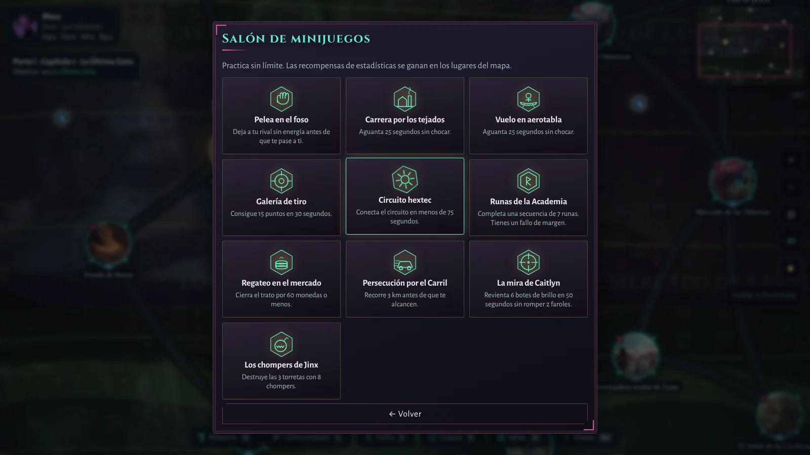
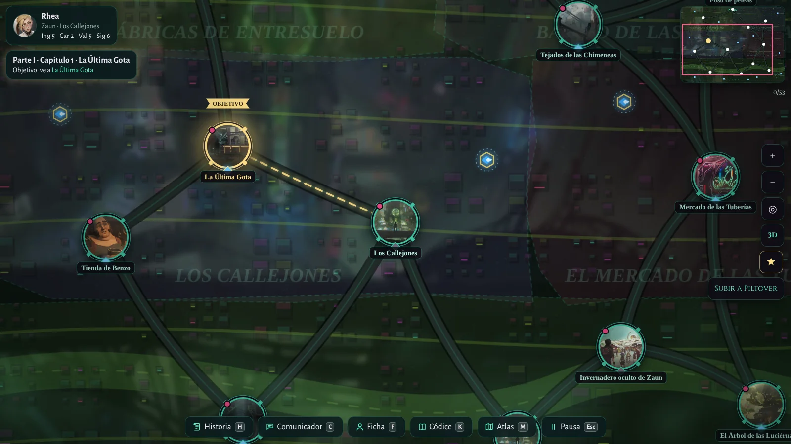

# GUIAJUEGO.md · Manual de usuario, primera partida y testing
**Para quien nunca ha jugado, para quien no conoce Arcane y para quien prueba el juego**

Esta guía no exige conocimientos de programación y evita spoilers importantes del argumento. Está dividida en tres modos de lectura:

- **Quiero jugar:** instrucciones para la primera partida.
- **No conozco Arcane:** contexto básico de las ciudades y personajes.
- **Quiero probar el juego:** lista de pruebas y una plantilla para informar de errores.

> **Sobre la bienvenida:** los datos del proyecto incluyen una guía rápida sin spoilers, con presentaciones distintas según el origen de la partida. No se debe asumir que todas las versiones muestran exactamente la misma pantalla inicial ni que preguntan literalmente «¿Conoces Arcane?». Revisa cómo se comporta la versión que estés probando.

## 1. Qué juego es este

Rifts & Gears es una aventura narrativa de fans inspirada en la atmósfera y el universo de *Arcane*. Creas tu propio personaje, decides de dónde viene, lees conversaciones, eliges cómo responde, exploras localizaciones y construyes relaciones con el reparto. También hay mapa, códice/atlas, actividades y minijuegos.

No necesitas saberte la serie ni jugar a *League of Legends*. Puedes empezar sin conocer a nadie y descubrir el mundo a medida que la historia te presenta a sus habitantes.

## 2. Introducción a Piltover y Zaun, sin spoilers

### Piltover: la ciudad alta

Piltover se conoce como la Ciudad del Progreso. Es una ciudad rica, con academias, inventores, familias influyentes y un Consejo que toma decisiones políticas. Sus edificios, su tecnología y su imagen elegante representan la promesa de que la ciencia y el ingenio pueden mejorar la vida.

Pero el progreso no llega de la misma forma a todo el mundo. La riqueza, la influencia y el control de la tecnología también crean tensiones.

### Zaun: la ciudad de abajo

Zaun es una ciudad industrial situada bajo la sombra de Piltover. Tiene talleres, callejones, humo químico, inventores improvisados, comerciantes, bandas y comunidades que intentan salir adelante. Es creativa y resistente, pero está marcada por desigualdad, contaminación y falta de oportunidades.

### Por qué importa la relación entre ambas

Las dos ciudades están conectadas y comparten una historia, pero no están de acuerdo en quién debe decidir el futuro ni quién se beneficia del progreso. Esa tensión social, junto con la familia, la lealtad, la ambición y las decisiones personales, impulsa la narración.

### Tres palabras que ayudan a orientarse

- **Hextech:** tecnología extraordinaria que combina ingeniería y una fuente de poder especial. Es uno de los símbolos del progreso de Piltover.
- **El Consejo:** el grupo de autoridades que gobierna Piltover.
- **La ciudad subterránea:** forma habitual de referirse a Zaun y sus barrios industriales.

No hace falta memorizar estos términos: la historia y la guía interna los contextualizan a medida que aparecen.

## 3. Quién es quién, en términos sencillos

Estas son descripciones generales de los personajes principales, sin revelar sus destinos. En distintos momentos de la historia sus relaciones pueden cambiar.

| Personaje | Para empezar |
|---|---|
| **Vi** | Peleadora de Zaun y hermana mayor de Powder. Es directa, protectora y suele actuar antes de pensar demasiado. |
| **Jinx / Powder** | Inventora con una imaginación enorme. Al principio de la historia se la conoce como Powder; el nombre Jinx pertenece a su recorrido narrativo. |
| **Ekko** | Joven inventor de Zaun, rápido de mente y comprometido con su comunidad. |
| **Caitlyn** | Tiradora de Piltover, procedente de una familia poderosa. Quiere investigar por sí misma y entender lo que ocurre en su ciudad. |
| **Jayce** | Inventor de Piltover que cree que la tecnología puede cambiar la vida de la gente. |
| **Viktor** | Científico brillante nacido en Zaun, que trabaja en la Academia y busca avances con impacto real. |
| **Mel** | Consejera de Piltover; es política, observadora y sabe que la influencia también se construye mediante negociación. |

Otros personajes pueden aparecer según el origen y el momento narrativo: Vander, Silco, Sevika, Heimerdinger, Cassandra, Ambessa, Isha y más. Si no reconoces un nombre, no significa que te hayas perdido algo: la historia puede presentarlo más adelante.

## 4. Primera partida: pasos recomendados

### Paso 1. Abre el menú principal

La pantalla principal incluye acciones para iniciar o continuar una partida, acceder a partidas guardadas y cambiar ajustes. Los nombres exactos pueden variar según la versión.

- **Nueva partida:** empieza el proceso de creación y una campaña nueva.
- **Continuar:** abre una partida reciente si existe un guardado válido.
- **Cargar partida:** permite entrar al menú/flujo de partidas guardadas.
- **Ajustes:** permite configurar opciones disponibles como sonido y gráficos.

Para aprender, elige **Nueva partida**. Si ya tienes una partida importante, no la sobrescribas para probar.

### Paso 2. Elige un origen

El creador te permite escoger entre Piltover y Zaun. Esto determina el punto de partida narrativo y las personas que se presentan al principio.

- Elige **Zaun** si te interesa una historia que comienza entre talleres, callejones y la vida industrial.
- Elige **Piltover** si prefieres comenzar entre academias, inventos e instituciones.

No hay una elección universalmente correcta. Escoge la que te intrigue y deja que la historia te enseñe el resto.

### Paso 3. Crea tu personaje

En el código actual, el creador está organizado en estos pasos:

1. **Origen:** ciudad de procedencia.
2. **Identidad:** datos básicos del protagonista.
3. **Clase:** estilo general del personaje.
4. **Habilidades:** elecciones de habilidades identificadas como Q, W, E y R.
5. **Aptitudes:** reparto de puntos entre ingenio, carisma, valor y sigilo.
6. **Retrato:** elegir la representación visual disponible.
7. **Familia y aficiones:** concretar vínculos y preferencias del personaje.
8. **Ficha final:** revisar la creación y confirmar.

Consejos para tu primera partida:

- Elige un nombre que quieras ver en los diálogos.
- Lee la descripción de cada clase y habilidad antes de decidir.
- Revisa los puntos de aptitud, porque representan distintos enfoques de resolución.
- Añade aficiones y datos de biografía que te ayuden a imaginar cómo reaccionaría tu personaje.
- Antes de confirmar, revisa el resumen final.

La importancia de cada habilidad o aptitud depende de las reglas de la versión que juegues. No hay que conocer el lore para tomar estas decisiones.

### Paso 4. Lee la guía del mundo

El juego dispone de datos para una guía rápida sin spoilers. El contenido cambia según el origen: quien empieza en Zaun conoce primero a las personas de esa ciudad; quien empieza en Piltover recibe contexto sobre sus inventores y autoridades. En una fase posterior puede aparecer un repaso con personajes nuevos.

Si conoces poco el universo, lee esas fichas sin prisa. Si ya conoces la serie, puedes usarlas como referencia rápida.

### Paso 5. Lee y decide

La historia se presenta en escenas y conversaciones. Lee el texto, revisa las opciones y selecciona la respuesta que mejor encaje con tu protagonista.

Las decisiones pueden influir en relaciones o eventos posteriores. No todas las elecciones tienen un efecto visible inmediato. Si una respuesta no ofrece una explicación completa, sigue jugando antes de concluir que se ha roto la historia.

### Paso 6. Explora el mapa

El mapa permite recorrer visualmente una ciudad y localizar puntos de interés. En función del dispositivo:

- En ordenador puedes utilizar ratón y teclado.
- En pantalla táctil puedes arrastrar, tocar los puntos de interés y utilizar gestos de zoom cuando estén disponibles.
- Puedes cambiar entre la vista 3D y la alternativa 2D si la versión o los ajustes lo permiten.

**Importante:** tocar un lugar del mapa puede abrir primero un menú contextual con acciones como historia, conversación, explorar, minijuego o viajar. No presupongas que un toque siempre lleva directamente a otra pantalla. Lee las opciones del lugar.

La captura del mapa sirve de referencia visual y podría no representar la interfaz exacta de todas las compilaciones.

### Paso 7. Conversa con los personajes

El juego tiene conversaciones con opciones escritas y una opción de chat libre con IA cuando está configurada.

- **Diálogo escrito:** selecciona respuestas preparadas por la historia. No requiere instalar un modelo.
- **Chat libre con IA:** permite escribir texto propio, pero depende de que haya proveedor, servidor y modelo disponibles. Puede responder lento o inventarse detalles; la calidad no está garantizada.
- Si la IA no está configurada, utiliza los diálogos escritos. No necesitas resolver la IA para completar una prueba básica de interfaz e historia.

Evita escribir información privada en un chat conectado a un servicio externo. Para IA local, la privacidad depende del equipo y de la configuración de red. Consulta [GUIA-LM-STUDIO.md](GUIA-LM-STUDIO.md) antes de permitir conexiones entre dispositivos.

### Paso 8. Prueba el Salón de minijuegos

El proyecto incluye una pantalla de actividades/minijuegos. Entra, lee las reglas que se muestran en cada uno y prueba más de una actividad. Los controles pueden variar según el minijuego y la plataforma.

No des por hecho que la captura antigua representa la lista exacta de actividades de la versión descargada. Úsala para reconocer visualmente la sección.

### Paso 9. Guarda tu progreso

Abre el menú de partidas y usa la ranura disponible. Para comprobar el guardado:

1. Guarda la partida.
2. Regresa al menú o cierra el juego de forma normal.
3. Abre de nuevo la aplicación.
4. Carga esa ranura.
5. Comprueba si conserva el protagonista, el punto de historia y las decisiones recientes.

Antes de hacer pruebas de actualización, exporta o copia tu partida. En Windows, la ubicación habitual documentada es:

~~~text
%APPDATA%\Arcane Piltover y Zaun\partidas
~~~

En Android, la partida se almacena dentro de la app salvo que se exporte. Sigue [partidas-guardadas-guia.md](partidas-guardadas-guia.md) para transferirla o recuperarla. No desinstales una app con guardados sin confirmar que la copia está a salvo.

## 5. Ajustes recomendados para empezar

No hay una configuración perfecta para todos los dispositivos. Como base:

- **Sonido:** deja un volumen cómodo y prueba música, ambiente y efectos por separado si aparecen esas opciones.
- **Gráficos:** si el mapa 3D va lento, selecciona opciones de calidad inferiores o la vista alternativa disponible.
- **Accesibilidad:** comprueba tamaño de pantalla, legibilidad, movimiento reducido y controles táctiles cuando existan.
- **IA:** déjala desactivada en la primera partida si lo que quieres es aprender el mundo y comprobar la historia sin instalaciones adicionales.
- **Partidas:** crea una ranura de prueba y conserva el guardado principal sin tocar.

## 6. Qué probar: plan de testing

Este plan sirve para probar una compilación sin editar el código. Haz una prueba a la vez y registra cualquier resultado inesperado.

### Prueba A. Arranque y menú

- [ ] La aplicación abre sin pantalla vacía.
- [ ] Los botones principales responden.
- [ ] Si no hay guardados, la opción de continuar se comporta de forma coherente.
- [ ] Los ajustes abren y permiten volver.
- [ ] La ventana se puede cerrar y abrir otra vez.

**Resultado esperado:** el menú se muestra y cada acción lleva a la pantalla apropiada.

### Prueba B. Bienvenida y lore para alguien nuevo

- [ ] La versión explica cómo empezar o permite acceder a una guía sin spoilers.
- [ ] La explicación de Piltover y Zaun se entiende sin haber visto la serie.
- [ ] La guía no cuenta muertes, giros importantes ni finales.
- [ ] Los nombres desconocidos tienen contexto suficiente para no confundir al jugador.
- [ ] Se puede cerrar/avanzar desde la guía y regresar al flujo del juego.

**Resultado esperado:** una persona nueva comprende el conflicto general de las ciudades sin que se le revele el argumento clave.

**Nota de diseño:** el código de datos tiene una guía de personajes sin spoilers en <code>src/data/guia.js</code>. Si se quiere probar una pregunta literal del tipo «¿Conoces Arcane?» con dos rutas de bienvenida, registra si aparece en la compilación concreta; no lo marques como implementado basándote solo en el contenido de esta documentación.

### Prueba C. Creación del protagonista

- [ ] Seleccionar origen.
- [ ] Introducir un nombre.
- [ ] Cambiar clase y habilidades.
- [ ] Repartir las aptitudes.
- [ ] Elegir retrato.
- [ ] Seleccionar familia y aficiones.
- [ ] Revisar la ficha final y confirmar.
- [ ] Usar atrás/siguiente sin perder opciones indebidamente.

**Resultado esperado:** la creación solo avanza cuando los campos obligatorios del paso están válidos; la ficha final corresponde a lo elegido.

### Prueba D. Historia y decisiones

- [ ] La primera escena aparece.
- [ ] El texto se puede leer completo y las opciones no quedan ocultas.
- [ ] Seleccionar cada opción disponible avanza o vuelve a un punto válido.
- [ ] No aparece una escena en blanco ni un ciclo imposible de salir.
- [ ] Las relaciones o indicadores visibles cambian cuando la escena lo indica.
- [ ] Se puede pausar o avanzar sin duplicar escenas.

**Resultado esperado:** todas las opciones conducen a una transición válida y el jugador puede continuar.

### Prueba E. Mapa y navegación

- [ ] El mapa abre y muestra la ciudad elegida.
- [ ] Los puntos de interés se distinguen del fondo.
- [ ] Arrastrar el mapa y hacer zoom no bloquea el resto de la interfaz.
- [ ] Tocar un punto abre las acciones esperadas.
- [ ] Las acciones de historia, conversación, explorar o viajar que estén disponibles responden.
- [ ] El mapa sigue usable si la vista 3D no está disponible o se elige la alternativa 2D.

**Resultado esperado:** se puede localizar y seleccionar un punto, leer sus opciones y volver al mapa.

### Prueba F. Personajes y chat

- [ ] Los personajes que la historia ha presentado pueden seleccionarse cuando corresponde.
- [ ] Los diálogos escritos muestran opciones y continúan.
- [ ] La IA desactivada no provoca un error que impida usar los diálogos escritos.
- [ ] Con IA habilitada, la configuración indica proveedor, dirección y modelo.
- [ ] Si el servidor está apagado, aparece un mensaje comprensible y el juego se mantiene utilizable.
- [ ] La respuesta del modelo no crea botones rotos, código ejecutable ni saltos arbitrarios de estado.

**Resultado esperado:** el sistema de conversación responde o falla de forma controlada, sin bloquear la partida.

### Prueba G. Audio

- [ ] La música empieza después de una interacción si el navegador lo requiere.
- [ ] El menú activa el tema correspondiente.
- [ ] Al cambiar de zona se actualiza el tema si esa función está implementada en esa compilación.
- [ ] Música, ambiente y efectos respetan los ajustes disponibles.
- [ ] Silenciar el audio no impide continuar el juego.
- [ ] No aparecen sonidos atascados tras cambiar de pantalla.

**Importante:** esta prueba corresponde al sistema de audio procedural actual. No marques como aprobada la reproducción de tres archivos externos hasta que existan y estén integrados.

### Prueba H. Minijuegos, atlas y códice

- [ ] Abre el Salón de minijuegos.
- [ ] Inicia un minijuego y sigue las reglas que aparecen.
- [ ] Comprueba que se puede completar o salir sin dejar la interfaz bloqueada.
- [ ] Abre el atlas/códice y verifica que los artículos se pueden consultar.
- [ ] Comprueba que la información no se pierde al volver a la historia.

### Prueba I. Guardado y recuperación

- [ ] Guarda una ranura de prueba.
- [ ] Cierra y vuelve a abrir.
- [ ] Carga la ranura y confirma que mantiene el protagonista y la historia.
- [ ] Exporta una ranura, si la opción aparece.
- [ ] Importa la copia en otra ranura y comprueba que se lee.
- [ ] No se pierde el guardado personal al actualizar.

**Resultado esperado:** la partida de prueba se puede recuperar. No uses el único guardado importante para validar una actualización.

### Prueba J. Adaptación a dispositivos

- [ ] Ordenador: teclado y ratón.
- [ ] Tableta/móvil: botones táctiles, controles visibles y texto legible.
- [ ] Pantalla estrecha: no hay desbordamiento horizontal que oculte botones importantes.
- [ ] Rotar o cambiar tamaño de ventana no deja el juego inutilizable.
- [ ] El audio y el guardado sobreviven al flujo normal de cerrar/abrir.

Prueba con las plataformas que realmente se vayan a distribuir. Un resultado en escritorio no valida automáticamente Android, y viceversa.

## 7. Controles

Los controles disponibles pueden depender de la pantalla, del dispositivo y de la versión. Sigue primero las pistas visibles de la interfaz.

La guía previa de modelos registra estos controles para la vista de mundo en la compilación que describe: movimiento con WASD/flechas, correr con Mayús, rotación de cámara con Q/R e interacción con E. Verifícalos en la versión que estés probando y anota si no coinciden. En pantalla táctil, busca los controles en pantalla; no presupongas que existe un teclado.

## 8. Cómo informar de un error útil

Un informe con pasos claros permite reproducir el problema mucho más fácilmente que un mensaje como «no funciona».

Copia y rellena esta plantilla:

~~~text
Título:
Versión del juego:
Dispositivo y sistema operativo:
Cómo se instaló: Release / artefacto de Actions / código fuente
Zona o pantalla:
Pasos para reproducir:
1.
2.
3.

Qué esperaba que ocurriera:
Qué ocurrió realmente:
¿Pasa siempre o solo una vez?:
¿Se puede volver al menú o queda bloqueado?:
Adjuntos: captura sin datos privados (si ayuda)
~~~

Antes de publicar una captura, elimina nombres reales, archivos personales, conversaciones privadas, claves y cualquier dato que no quieras hacer público. Si se trata de un spoiler, indícalo en el título del informe.

## 9. Qué hacer cuando algo no va

| Problema | Primer paso seguro |
|---|---|
| El juego no abre | Comprueba que descargaste el archivo de la versión correcta. En una build de desarrollo, ejecuta la comprobación del proyecto. |
| No puedes continuar | Comprueba si existe una ranura guardada; inicia una partida de prueba aparte para comparar. |
| El mapa va lento | Baja la calidad disponible y comprueba si la vista alternativa ayuda. |
| Un personaje no aparece | Continúa la historia hasta que se presente; si debería estar disponible, registra la ubicación y la versión. |
| No hay respuestas de IA | Usa el diálogo escrito y verifica servidor/modelo después; la IA es opcional. |
| No hay sonido | Revisa volumen, silencio y ajustes; prueba después de interactuar con la pantalla. |
| No carga una partida | No la borres ni la reemplaces. Copia la carpeta o el archivo antes de probar una recuperación. |
| La pantalla táctil no responde | Cierra y vuelve a abrir; registra dispositivo, orientación y pantalla afectada. |

## 10. Capturas de referencia incluidas en el repositorio

Las capturas siguientes son reales y están guardadas en <code>capturasjuego/</code>. Se incluyen para ayudar a reconocer las pantallas, no como garantía de que cada píxel coincida con la última compilación.

| Captura | Para qué sirve |
|---|---|
|  | Reconocer la pantalla inicial. |
|  | Orientarse en la creación. |
|  | Reconocer la vista 3D. |
|  | Reconocer puntos de interés y navegación. |
|  | Encontrar el área de actividades. |

Para ver el historial de imágenes y su versión de origen, abre [capturasjuego/README.md](capturasjuego/README.md).

## 11. Si quieres continuar después de la primera partida

- Para mover o recuperar guardados: [partidas-guardadas-guia.md](partidas-guardadas-guia.md).
- Para habilitar la IA con un modelo local: [GUIA-LM-STUDIO.md](GUIA-LM-STUDIO.md).
- Para entender cómo está programado el juego: [GUIA.md](GUIA.md).
- Para probar modelos 3D personales: [GUIA-MODELOS-3D-Y-PRUEBAS.md](GUIA-MODELOS-3D-Y-PRUEBAS.md).

Disfruta el viaje a tu ritmo: para comenzar no necesitas conocer toda la historia; basta con elegir un origen y prestar atención a las personas que conozcas por el camino.
